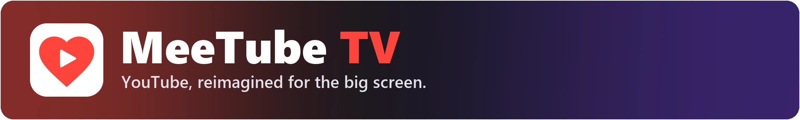
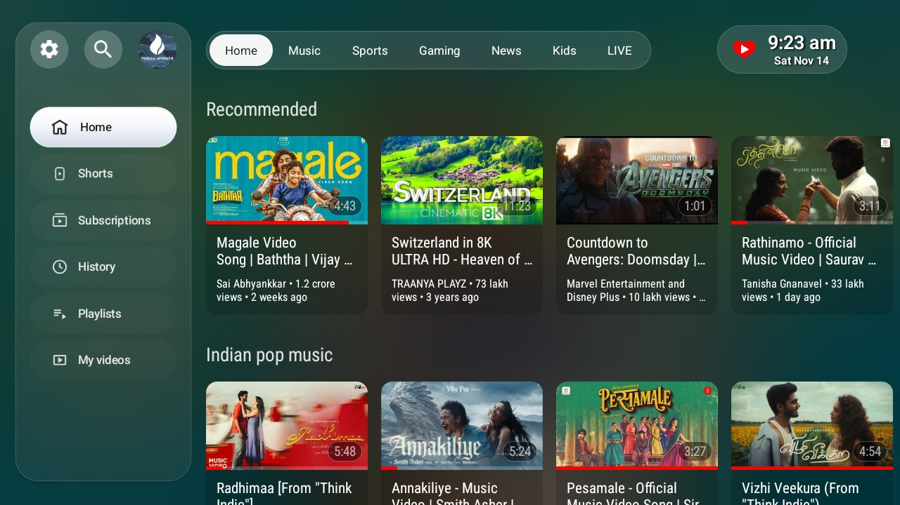
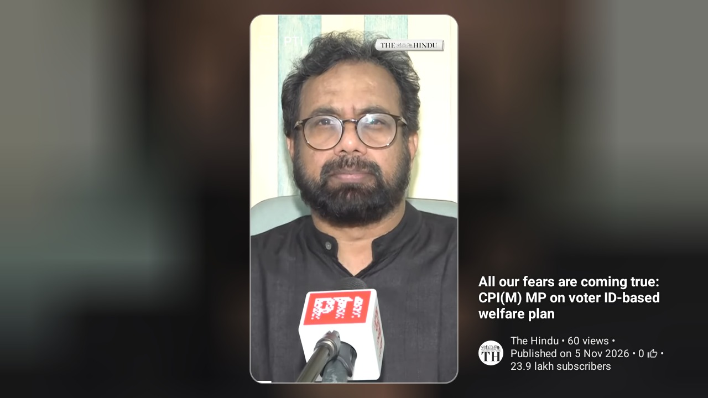
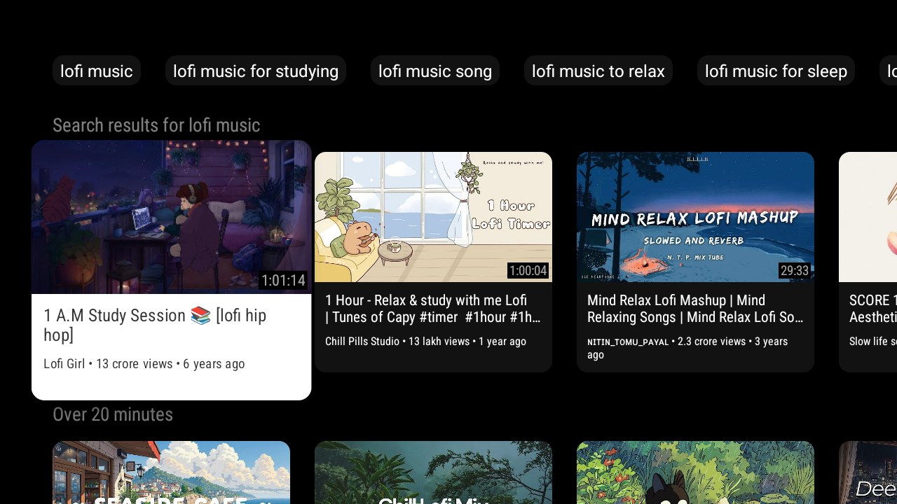
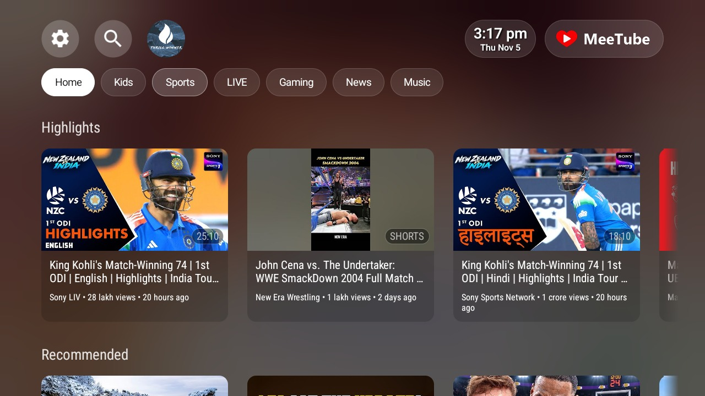

<p align="center"></p>

<p align="center">
<a href="https://github.com/yashoncode/meetube-tv/releases/latest"></a>
<a href="LICENSE"></a>
<a href="https://github.com/yashoncode/meetube-tv/releases"></a>
<a href="https://buymeacoffee.com/yashwynth"></a>
</p>

<h3 align="center"><a href="#download">⬇ Download MeeTube TV</a></h3>

<p align="center"><a href="CHANGELOG.md">What's new</a> · <a href="#meetube-for-your-phone">On a phone? Get MeeTube</a></p>

<p align="center">




</p>

> [!IMPORTANT]
> MeeTube TV is not affiliated with, endorsed by, or connected to YouTube or Google in any way. Use it at your own discretion.

## About

MeeTube TV is an aesthetic YouTube app for Android TV, Google TV and Fire TV. Every screen is made for the couch, with frosted glass, soft glows and calm motion. It's [MeeTube](https://github.com/yashoncode/meetube) for the big screen.

## What MeeTube TV does

<table>
<tr>
<td width="50%"></td>
<td width="50%">

### Glass, made for the couch
A frosted sidebar floats over Home, with a focus pill that glides between its icons. Home's chips are glass too, and the card you're on gets a soft glowing ring.

</td>
</tr>
<tr>
<td></td>
<td>

### Press OK, and it plays
Rest on a video and MeeTube TV loads it in the background, so it starts in about a second, even on a 1 GB TV. The player keeps the title at the top and every button in one row at the bottom.

</td>
</tr>
<tr>
<td></td>
<td>

### Shorts, made for the big screen
Each short plays in a rounded 9:16 card with its colours glowing on both sides. Up and down move between them, and OK pauses.

</td>
</tr>
<tr>
<td></td>
<td>

### Search that glows
The edges of the screen light up when Search or voice search opens, and your words glow as you type.

</td>
</tr>
<tr>
<td></td>
<td>

### Something for everyone
Kids, Sports, Live, Gaming, News and Music sit right next to Home, one click away.

</td>
</tr>
<tr>
<td></td>
<td>

### Your account, if you want one
Sign in with a code and Subscriptions shows every channel as a round avatar. Or skip it and use MeeTube TV without an account.

</td>
</tr>
</table>

### And more

| | |
|---|---|
| **No ads** | Ads are gone, and SponsorBlock asks before skipping sponsors, intros and "like and subscribe" reminders. |
| **Real dislikes** | Return YouTube Dislike puts the real count on the dislike button, and DeArrow swaps clickbait titles and thumbnails. |
| **AV1** | On TVs that support it, videos are about 30% smaller than VP9 for the same picture, so they start sooner and stall less. |
| **Light on your TV** | Built for 1 GB boxes: about 50 MB less memory while a video plays, and quick to open after every update. |
| **Updates itself** | MeeTube TV finds its new versions and installs them. |
| **Remote, mouse or keyboard** | Made for the D-pad, and the mouse wheel scrolls the same way. |

## Download

Get it from [the latest release](https://github.com/yashoncode/meetube-tv/releases/latest):

| Your TV | File |
|:--|:--|
| Most TVs and boxes | [MeeTubeTV_1.1.1_armeabi-v7a.apk](https://github.com/yashoncode/meetube-tv/releases/download/tv-v1.1.1/MeeTubeTV_1.1.1_armeabi-v7a.apk) |
| Newer 64-bit boxes (Nvidia Shield, Google TV Streamer) | [MeeTubeTV_1.1.1_arm64-v8a.apk](https://github.com/yashoncode/meetube-tv/releases/download/tv-v1.1.1/MeeTubeTV_1.1.1_arm64-v8a.apk) |
| Not sure | [MeeTubeTV_1.1.1_universal.apk](https://github.com/yashoncode/meetube-tv/releases/download/tv-v1.1.1/MeeTubeTV_1.1.1_universal.apk) |

Android 4.2 or later. What changed is in the [changelog](CHANGELOG.md). Found a bug? [Open an issue](https://github.com/yashoncode/meetube-tv/issues/new/choose).

Every release is built and signed in public by [GitHub Actions](https://github.com/yashoncode/meetube-tv/actions/workflows/release-tv.yml) from this repository's source, so you can see exactly how each APK was made.

## MeeTube for your phone

MeeTube TV has a sister app for phones and tablets: liquid glass, synced lyrics, background playback and one-tap downloads.

<p align="center"></p>

Get the APK from [MeeTube's Releases](https://github.com/yashoncode/meetube/releases/latest):

| Your device | File |
|:--|:--|
| Most phones (64-bit) | `MeeTube_<version>_arm64-v8a.apk` |
| Older phones (32-bit) | `MeeTube_<version>_armeabi-v7a.apk` |
| Not sure | `MeeTube_<version>_universal.apk` |

Android 7.0 or later. More on the phone app in [MeeTube's README](https://github.com/yashoncode/meetube#readme).

## Build

JDK 17, then:

```
git clone --recurse-submodules https://github.com/yashoncode/meetube-tv.git
./gradlew :smarttubetv:assembleStstableRelease   # release, signed with keystore.properties if present
# APKs: smarttubetv/build/outputs/apk/ststable/release/MeeTubeTV_<version>_<abi>.apk
```

Releases are made by pushing a `tv-vX.Y.Z` tag (`tv-vX.Y.Z-beta` for a beta) on `main`: [release-tv.yml](.github/workflows/release-tv.yml) builds the signed APKs and publishes the release. A stable release commit also bumps [meetube_tv.json](meetube_tv.json), which the in-app updater reads. Add `-PtvAbi=x86_64` for a one-ABI build that runs on an x86_64 TV emulator. The backend lives in the `MediaServiceCore` and `SharedModules` submodules. Developer notes are in [CLAUDE.md](CLAUDE.md).

## Support MeeTube

Behind every little feature are hours of my life, a few sleepless nights, and a lot of hope that someone out there finds it useful.

❤️ If you love my work, buy me a coffee. ☕<br>
If you don't, maybe buy me a tea? 🍵

No pressure, though. I built this with love, not expectations. ❤️

<p align="center"><a href="https://buymeacoffee.com/yashwynth"></a></p>

In India? Scan to send a coffee (or a chai) over UPI (`yashwynth@slc`):

<p align="center"></p>

A star on GitHub or sharing MeeTube TV with a friend helps just as much. Thank you for using it! ❤️

## Credits

Big thanks to [SmartTube](https://github.com/yuliskov/SmartTube) by [@yuliskov](https://github.com/yuliskov). Their open source work made MeeTube TV possible.

## License

MIT, see [LICENSE](LICENSE). The original SmartTube copyright notice is kept.
