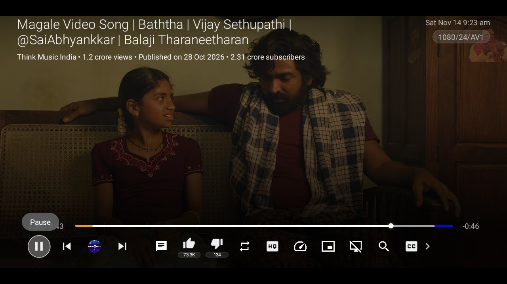
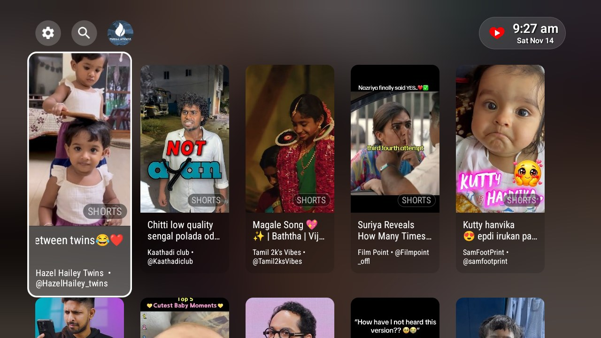
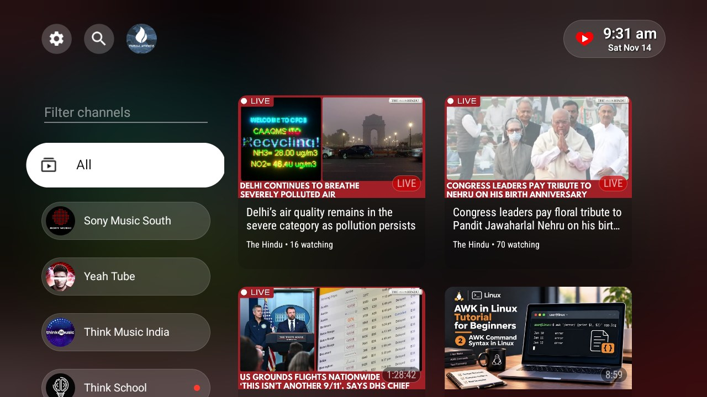
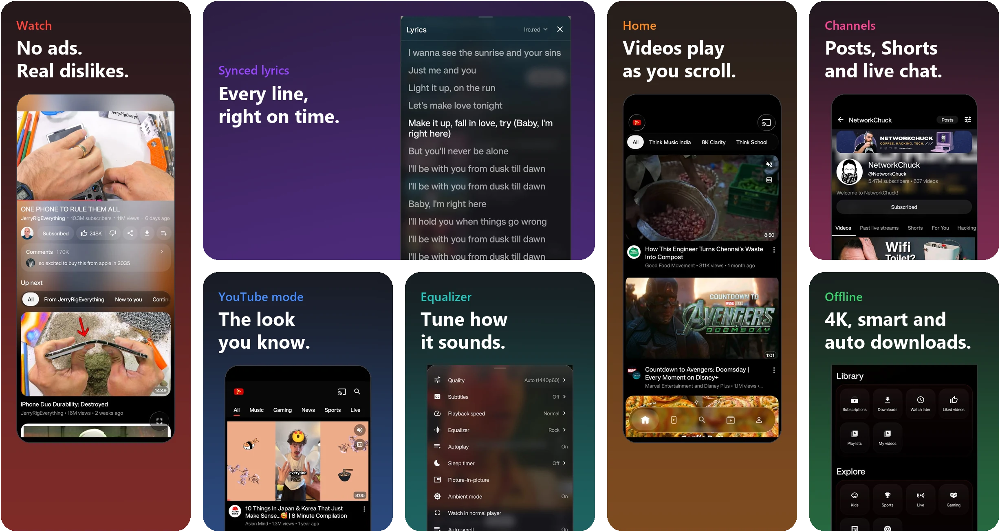

<div align="center">


# MeeTube TV

**YouTube, made for the couch.**<br>
A free YouTube app for Android TV, Google TV and Fire TV.<br>
Clear glass, no ads, and videos that start the moment you press OK.

[](https://github.com/yashoncode/meetube-tv/releases/latest)

[](LICENSE)
[](https://buymeacoffee.com/yashwynth)

### [⬇ Download MeeTube TV](#install)

[What's new](https://github.com/yashoncode/meetube-tv/releases/latest) · [All changes](CHANGELOG.md) · [On a phone? Get MeeTube](#meetube-for-your-phone)





</div>

> [!NOTE]
> MeeTube TV is an independent, unofficial app. It is not affiliated with, endorsed by, or connected to Google or YouTube.

## Install

1. On your TV, download the APK for your TV from the [latest release](https://github.com/yashoncode/meetube-tv/releases/latest), with the Downloader app or any browser:

| Your TV | APK |
|:--|:--|
| Most TVs and boxes | [MeeTubeTV_1.1.1_armeabi-v7a.apk](https://github.com/yashoncode/meetube-tv/releases/download/tv-v1.1.1/MeeTubeTV_1.1.1_armeabi-v7a.apk) |
| Newer 64-bit boxes (Nvidia Shield, Google TV Streamer) | [MeeTubeTV_1.1.1_arm64-v8a.apk](https://github.com/yashoncode/meetube-tv/releases/download/tv-v1.1.1/MeeTubeTV_1.1.1_arm64-v8a.apk) |
| Not sure | [MeeTubeTV_1.1.1_universal.apk](https://github.com/yashoncode/meetube-tv/releases/download/tv-v1.1.1/MeeTubeTV_1.1.1_universal.apk) |

2. Open it. Android will ask you to allow installs from that app.
3. That's it. Sign in with a code to see your subscriptions, or skip that.

Updates: MeeTube TV finds its new versions and installs them. Your history and settings are kept.

## New in 1.1.1

A bigger, calmer Home.

- **Bigger cards,** set closer together, with a bigger clock and bigger chips: Home, Music, Sports, Gaming, News, Kids and LIVE.
- **A lighter player:** the controls are a little smaller, the seek bar keeps its size, and arrows show when more buttons are hidden.
- **Quiet by default:** cards no longer play a preview while you rest on them. Turn it back on in Settings.
- **Its own home:** MeeTube TV now lives at [yashoncode/meetube-tv](https://github.com/yashoncode/meetube-tv), and updates come from here.
- **Fixes** for the sidebar glass stopping short, the chips flickering, a focused short running into the row below, and the player's clock.

See every change in the [changelog](CHANGELOG.md).

<p align="center">


</p>

## What MeeTube TV does

<table>
<tr>
<td width="50%"></td>
<td width="50%">

### Glass, made for the couch
A clear glass sidebar floats over Home, and a pill glides between its icons. The card you're on lifts and gets a soft white ring.

</td>
</tr>
<tr>
<td></td>
<td>

### Press OK, and it plays
Rest on a video and MeeTube TV gets it ready, so it starts in about a second, even on a 1 GB TV. The title sits at the top and every button in one row at the bottom.

</td>
</tr>
<tr>
<td></td>
<td>

### Shorts, done right
Each short plays in a rounded 9:16 card with its colors glowing around it. Up and down move between them, and OK pauses.

</td>
</tr>
<tr>
<td></td>
<td>

### Find it fast
Type or say what you want. Suggestions sit in pills across the top, and the results line up in rows below.

</td>
</tr>
<tr>
<td></td>
<td>

### Something for everyone
Music, Sports, Gaming, News, Kids and LIVE sit right next to Home, one click away.

</td>
</tr>
<tr>
<td></td>
<td>

### No account needed
Watch without signing in. Or sign in with a code, and Subscriptions shows every channel as a round avatar.

</td>
</tr>
</table>

### And more

| | |
|---|---|
| **No ads** | Ads are gone, and SponsorBlock skips sponsors, intros and "like and subscribe" reminders. |
| **Real dislikes** | Return YouTube Dislike shows the real count, and DeArrow swaps clickbait titles and thumbnails. |
| **AV1** | On TVs that support it, videos are about 30% smaller for the same picture, so they start sooner and stall less. |
| **Light on your TV** | Built for 1 GB boxes, and quick to open after every update. |
| **Remote, mouse or keyboard** | Made for the D-pad, and the mouse wheel scrolls too. |

Every release is built and signed in public by [GitHub Actions](https://github.com/yashoncode/meetube-tv/actions/workflows/release-tv.yml) from this repo's source, so you can see how each APK was made.

## Help out

Bug reports and ideas are welcome in [Issues](https://github.com/yashoncode/meetube-tv/issues/new/choose).

## MeeTube for your phone

MeeTube TV has a sister app for phones and tablets: liquid glass, synced lyrics, background playback and one-tap downloads.

<p align="center"></p>

Get the APK from [MeeTube's Releases](https://github.com/yashoncode/meetube/releases/latest):

| Your device | File |
|:--|:--|
| Most phones (64-bit) | `MeeTube_<version>_arm64-v8a.apk` |
| Older phones (32-bit) | `MeeTube_<version>_armeabi-v7a.apk` |
| Not sure | `MeeTube_<version>_universal.apk` |

Android 7.0 or later. More on the phone app in [MeeTube's README](https://github.com/yashoncode/meetube#readme).

## Build

JDK 17, then:

```
git clone --recurse-submodules https://github.com/yashoncode/meetube-tv.git
./gradlew :smarttubetv:assembleStstableRelease   # release, signed with keystore.properties if present
# APKs: smarttubetv/build/outputs/apk/ststable/release/MeeTubeTV_<version>_<abi>.apk
```

Releases are made by pushing a `tv-vX.Y.Z` tag (`tv-vX.Y.Z-beta` for a beta) on `main`: [release-tv.yml](.github/workflows/release-tv.yml) builds the signed APKs and publishes the release. A stable release commit also bumps [meetube_tv.json](meetube_tv.json), which the in-app updater reads. Add `-PtvAbi=x86_64` for a one-ABI build that runs on an x86_64 TV emulator. The backend lives in the `MediaServiceCore` and `SharedModules` submodules. Developer notes are in [CLAUDE.md](CLAUDE.md).

## Support MeeTube

Behind every little feature are hours of my life, a few sleepless nights, and a lot of hope that someone out there finds it useful.

❤️ If you love my work, buy me a coffee. ☕<br>
If you don't, maybe buy me a tea? 🍵

No pressure, though. I built this with love, not expectations. ❤️

<p align="center"><a href="https://buymeacoffee.com/yashwynth"></a></p>

In India? Scan to send a coffee (or a chai) over UPI (`yashwynth@slc`):

<p align="center"></p>

A star on GitHub or sharing MeeTube TV with a friend helps just as much. Thank you for using it! ❤️

## Credits

Big thanks to [SmartTube](https://github.com/yuliskov/SmartTube) by [@yuliskov](https://github.com/yuliskov). Their open source work made MeeTube TV possible.

## License

MIT, see [LICENSE](LICENSE). The original SmartTube copyright notice is kept.
