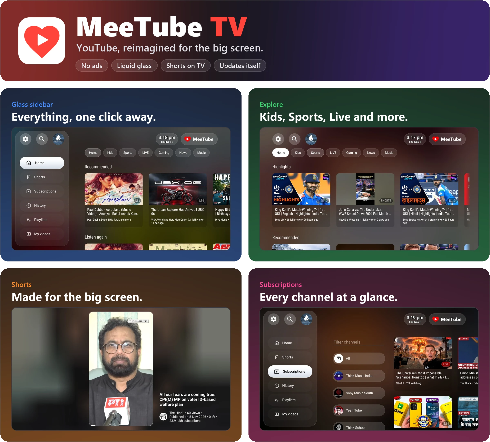
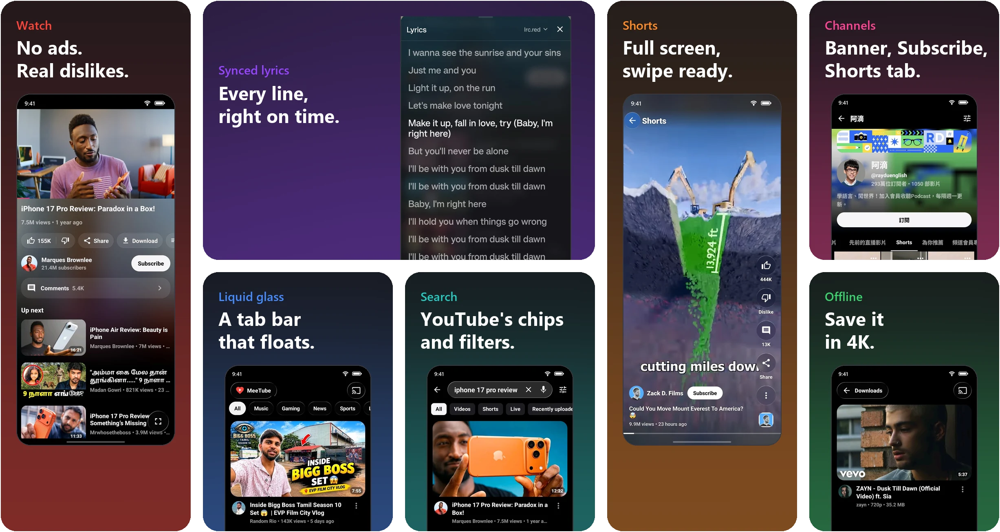

<p align="center"></p>

<h1 align="center">MeeTube TV</h1>

<p align="center">
<a href="#download"></a>
<a href="LICENSE"></a>
<a href="#support-meetube"></a>
</p>

**YouTube on the big screen, reimagined. Different by design. Smooth by nature.** <br><br> No ads. No interruptions. Just a gorgeous glass interface, Shorts done right, and videos that start almost the moment you press OK.<br><br> **A fresh way to watch YouTube on your TV.**<br><br>

<p align="center"></p>

<p align="center"><a href="#download"><b>⬇ Download the latest MeeTube TV</b></a></p>

<p align="center"></p>

<p align="center"><a href="#meetube-for-your-phone"><b>📱 On a phone? Get MeeTube</b></a></p>

> [!IMPORTANT]
> MeeTube TV is not affiliated with, endorsed by, or connected to YouTube or Google in any way. Use it at your own discretion.

## About

MeeTube TV is an aesthetic TV UI YouTube app for Android TV, Google TV and Fire TV. Every screen is made for the couch: frosted glass, soft glows and calm motion, tuned to stay smooth even on a 1 GB box. It's the TV sister of [MeeTube](https://github.com/yashoncode/meetube) and installs as its own app.

## Features

<table>
<tr>
<td width="50%" valign="top">⚡ <b>Starts almost at once</b><br>Rest on a video card and MeeTube TV loads it in the background, so OK only has to start the player. On a 1 GB TV a video starts in about a second.</td>
<td width="50%" valign="top">💎 <b>Glass everywhere</b><br>A floating frosted sidebar with a focus pill that glides between MeeTube's icons, glass chips on Home and a glowing ring on the card you're on.</td>
</tr>
<tr>
<td valign="top">🚫 <b>No ads, no sponsors</b><br>Ads are gone, and SponsorBlock asks before skipping sponsors, intros and "like and subscribe" reminders.</td>
<td valign="top">📱 <b>Shorts done right</b><br>Each short plays in a rounded 9:16 card with its colours glowing on both sides. Up and down page through them, OK pauses.</td>
</tr>
<tr>
<td valign="top">🎬 <b>A cleaner player</b><br>One frosted panel: a white seek bar with a glowing knob, the time left, and every button in a single row.</td>
<td valign="top">✨ <b>Search that glows</b><br>The screen's edges light up when Search or voice search opens, and your words glow as you type.</td>
</tr>
<tr>
<td valign="top">🎞️ <b>AV1 on TVs that support it</b><br>About 30% smaller than VP9 for the same picture, so videos start sooner and stall less.</td>
<td valign="top">🪶 <b>Light on your TV</b><br>Built for 1 GB boxes: about 50 MB less memory while a video plays, and quick to open after every update.</td>
</tr>
<tr>
<td valign="top">👎 <b>Dislikes are back</b><br>Return YouTube Dislike puts the real count on the dislike button, and DeArrow swaps clickbait titles and thumbnails.</td>
<td valign="top">🔐 <b>Your account, your subscriptions</b><br>Sign in with a code, or use it without an account. Subscriptions show every channel as a round avatar.</td>
</tr>
<tr>
<td valign="top">🔄 <b>Updates itself</b><br>MeeTube TV finds its own new versions and installs them. It installs as its own app, next to anything else you have.</td>
<td valign="top">🖱️ <b>Remote, mouse or keyboard</b><br>Made for the D-pad, and the mouse wheel scrolls just like it.</td>
</tr>
</table>

## Download

Get it from [MeeTube TV 1.1.0](https://github.com/yashoncode/meetube/releases/tag/tv-v1.1.0) on Releases:

| Your TV | File |
|:--|:--|
| Most TVs and boxes | [MeeTubeTV_1.1.0_armeabi-v7a.apk](https://github.com/yashoncode/meetube/releases/download/tv-v1.1.0/MeeTubeTV_1.1.0_armeabi-v7a.apk) |
| Newer 64-bit boxes (Nvidia Shield, Google TV Streamer) | [MeeTubeTV_1.1.0_arm64-v8a.apk](https://github.com/yashoncode/meetube/releases/download/tv-v1.1.0/MeeTubeTV_1.1.0_arm64-v8a.apk) |
| Not sure | [MeeTubeTV_1.1.0_universal.apk](https://github.com/yashoncode/meetube/releases/download/tv-v1.1.0/MeeTubeTV_1.1.0_universal.apk) |

Android 4.2 or later. New releases appear on this repo's [Releases](https://github.com/yashoncode/meetube-tv/releases), and what changed is in the [changelog](CHANGELOG.md). Found a bug? [Open an issue](https://github.com/yashoncode/meetube-tv/issues/new/choose).

Every release is built and signed in public by [GitHub Actions](https://github.com/yashoncode/meetube-tv/actions/workflows/release-tv.yml) from this repository's source, so you can see exactly how each APK was made.

## MeeTube for your phone

MeeTube TV has a sister app for phones and tablets: liquid glass, synced lyrics, background playback and one-tap downloads. Get the APK from [MeeTube's Releases](https://github.com/yashoncode/meetube/releases/latest):

| Your device | File |
|:--|:--|
| Most phones (64-bit) | `MeeTube_<version>_arm64-v8a.apk` |
| Older phones (32-bit) | `MeeTube_<version>_armeabi-v7a.apk` |
| Not sure | `MeeTube_<version>_universal.apk` |

Android 7.0 or later. More on the phone app in [MeeTube's README](https://github.com/yashoncode/meetube#readme).

## Build

JDK 17, then:

```
git clone --recurse-submodules https://github.com/yashoncode/meetube-tv.git
./gradlew :smarttubetv:assembleStstableRelease   # release, signed with keystore.properties if present
# APKs: smarttubetv/build/outputs/apk/ststable/release/MeeTubeTV_<version>_<abi>.apk
```

Releases are made by pushing a `tv-vX.Y.Z` tag (`tv-vX.Y.Z-beta` for a beta) on `main`: [release-tv.yml](.github/workflows/release-tv.yml) builds the signed APKs and publishes the release. A stable release commit also bumps [meetube_tv.json](meetube_tv.json), which the in-app updater reads. Add `-PtvAbi=x86_64` for a one-ABI build that runs on an x86_64 TV emulator. The backend lives in the `MediaServiceCore` and `SharedModules` submodules. Developer notes are in [CLAUDE.md](CLAUDE.md).

## Support MeeTube

Behind every little feature are hours of my life, a few sleepless nights, and a lot of hope that someone out there finds it useful.

❤️ If you love my work, buy me a coffee. ☕<br>
If you don't, maybe buy me a tea? 🍵

No pressure, though. I built this with love, not expectations. ❤️

<p align="center"><a href="https://buymeacoffee.com/yashwynth"></a></p>

In India? Scan to send a coffee (or a chai) over UPI (`yashwynth@slc`):

<p align="center"></p>

A star on GitHub or sharing MeeTube TV with a friend helps just as much. Thank you for using it! ❤️

## Credits

Big thanks to [SmartTube](https://github.com/yuliskov/SmartTube) by [@yuliskov](https://github.com/yuliskov) and [NewTube](https://github.com/aleixrodriala/newtube) by [@aleixrodriala](https://github.com/aleixrodriala). Their open source work made MeeTube and MeeTube TV possible.

And thank you to everyone who sent a fix, reported a bug or suggested an idea. MeeTube is better because of you:

<p align="center">
<a href="https://github.com/KrishnakantShedge" title="KrishnakantShedge"></a>
<a href="https://github.com/Ishaanj2007" title="Ishaanj2007"></a>
<a href="https://github.com/alibinarshad" title="alibinarshad"></a>
<a href="https://github.com/sushi1579" title="sushi1579"></a>
<a href="https://github.com/y4hya3" title="y4hya3"></a>
<a href="https://github.com/dhanunjay333i-cyber" title="dhanunjay333i-cyber"></a>
<a href="https://github.com/y198h" title="y198h"></a>
<a href="https://github.com/editmatrix" title="editmatrix"></a>
<a href="https://github.com/94Dan" title="94Dan"></a>
<a href="https://github.com/Evergreenpro" title="Evergreenpro"></a>
<a href="https://github.com/Batmancpu" title="Batmancpu"></a>
<a href="https://github.com/karthick4568" title="karthick4568"></a>
<a href="https://github.com/Hrcosmos" title="Hrcosmos"></a>
<a href="https://github.com/abdulsamiamiri11-lang" title="abdulsamiamiri11-lang"></a>
<a href="https://github.com/m0in01" title="m0in01"></a>
<a href="https://github.com/mygtvact" title="mygtvact"></a>
<a href="https://github.com/ra-rear" title="ra-rear"></a>
<a href="https://github.com/harshXigll" title="harshXigll"></a>
<a href="https://github.com/AshUchiha3" title="AshUchiha3"></a>
<a href="https://github.com/abanbinarshadmail-dotcom" title="abanbinarshadmail-dotcom"></a>
<a href="https://github.com/jokychan797-stack" title="jokychan797-stack"></a>
<a href="https://github.com/Capricornus007" title="Capricornus007"></a>
<a href="https://github.com/Reird" title="Reird"></a>
<a href="https://github.com/MAKAKAIglitch" title="MAKAKAIglitch"></a>
<a href="https://github.com/sakuraDev31" title="sakuraDev31"></a>
<a href="https://github.com/SpadezOfSpadez" title="SpadezOfSpadez"></a>
<a href="https://github.com/Golukumar00" title="Golukumar00"></a>
<a href="https://github.com/froost4" title="froost4"></a>
<a href="https://github.com/kazierski" title="kazierski"></a>
<a href="https://github.com/Hammoudi99" title="Hammoudi99"></a>
<a href="https://github.com/kadheerk49" title="kadheerk49"></a>
<a href="https://github.com/GeorgAR" title="GeorgAR"></a>
<a href="https://github.com/akshaymaurya26" title="akshaymaurya26"></a>
<a href="https://github.com/muksidulrahman077-creator" title="muksidulrahman077-creator"></a>
<a href="https://github.com/upt8543-eng" title="upt8543-eng"></a>
<a href="https://github.com/debugging03" title="debugging03"></a>
<a href="https://github.com/DarkGGM" title="DarkGGM"></a>
<a href="https://github.com/Abinpj1" title="Abinpj1"></a>
<a href="https://github.com/Subbarao6338" title="Subbarao6338"></a>
<a href="https://github.com/sauravdahalbro-ui" title="sauravdahalbro-ui"></a>
</p>

## License

MIT, see [LICENSE](LICENSE). The original SmartTube copyright notice is kept.
